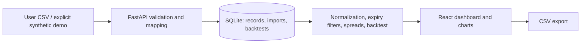

# GoldLens — Commodity Derivatives Intelligence

**Team Vision Forge · Hack in Hills** — “See Beyond the Gold Price.” GoldLens is a local research prototype that ingests market CSVs, preserves each observation's source, applies explicit unit assumptions, compares same-date contracts with expiry filters, identifies statistical spread outliers, and runs a cost-aware exploratory simulation.

> Demo prices are synthetic and are **not real MCX market prices**. Imported CSVs are user supplied and not independently authenticated. An unusual spread is a research lead, not a guaranteed or executable trade.

## Features

- React/Vite responsive research dashboard with price and spread charts, contract comparison, anomaly explanations, CSV data management, methodology and simulated backtest views.
- FastAPI routes and interactive Swagger docs, Pandas/NumPy calculations, SQLite persistence for records/imports/backtests.
- CSV upload validates dates, supported symbols, positive prices and duplicate date/symbol/expiry records; rejected rows and warnings are reported. Optional quotation basis is `quotation_grams`; optional purity is a fraction from 0 to 1. Missing values default to 1 and are warned. Specifications remain unverified.
- Formula: `normalized price per gram = quoted price / quotation_grams × purity_fraction`. The demo explicitly uses a 1 g analytical basis to exercise the pipeline; this is not an official contract specification.
- Expiry mismatches and optional minimum volume gate comparison eligibility. Rolling z-scores use prior observations only. Backtest costs reduce simulated P&L; result units are spread-price units, without contract multipliers or hedge ratios.

## Run on Windows PowerShell

From this project directory, use two terminals.

```powershell
py -m venv .venv
.\.venv\Scripts\Activate.ps1
pip install -r backend\requirements.txt
uvicorn backend.app.main:app --reload --port 8000
```

```powershell
cd frontend
npm install
npm run dev
```

Open the frontend at <http://localhost:5173> and the API documentation at <http://localhost:8000/docs>. Set `VITE_API_URL` before starting Vite to use another API address. Data lives in `data/goldlens.sqlite3`; set `GOLDLENS_DATA_DIR` to change its location.

## Demo and workflow

1. Select **Load demo data**. It generates a repeatable 150-observation synthetic series for GOLDM, GOLDTEN, GOLDGUINEA and GOLDPETAL, including a deliberately designed transient spread deviation.
2. Review the source banner, normalized price charts and pair comparison. A comparison uses same-date data and expiry/liquidity filters.
3. Review unusual spread alerts and their configured statistical explanation.
4. In Backtesting Lab, run the default prior-window reversion simulation. It reports completed trades, estimated transaction costs, net spread-unit P&L and limitations. No out-of-sample claim is made.
5. In Data Management, import a CSV and inspect accepted/rejected/warning counts. Export the records CSV.

Suggested columns: `trading_date,symbol,expiry_date,open,high,low,close,settlement_price,volume,open_interest,quotation_grams,purity`. Accepted symbols are GOLDM, GOLDTEN, GOLDGUINEA and GOLDPETAL. `date`, `trade_date`, `contract`, `expiry`, `settle`, `settlement`, `price`, `qty` and `oi` are recognized alternatives. Review the response warning before relying on normalized comparisons.

## Tests

```powershell
pip install -r backend\requirements.txt
pip install pytest httpx
pytest -q
```

## Structure

```text
backend/app/main.py       FastAPI, ingestion, SQLite, analysis and backtest
frontend/src/main.tsx     React dashboard and API client
frontend/src/style.css    Responsive visual system
tests/test_core.py        API and calculation workflow checks
data/                     Local SQLite database (ignored by Git)
```

## Architecture



## Limitations and responsible use

Official quotation bases, purity, contract multipliers, listing history and expiry conventions are not bundled or independently verified. This prototype does not retrieve live market data or use TinyFish. Missing unit metadata defaults to one and must be corrected by the user. Comparisons are research summaries, not proof contracts are simultaneously tradable. Backtest settlement prices are not guaranteed fills; costs are simplified, no out-of-sample split is calculated, and simulation results are not evidence of future profitability. Do not use this prototype as investment advice.

## Demo troubleshooting

- If the dashboard says the API is disconnected, start the backend at port 8000 and refresh.
- If npm or pip dependencies are absent, install them with the commands above; initial installs require package registry access.
- The synthetic demo only seeds an empty database; it does not overwrite imported records. Use a fresh `GOLDLENS_DATA_DIR` for a clean presentation.
- If a CSV import is rejected, check ISO-style dates, supported symbol names, positive `close`/`settlement_price`, and duplicate date/symbol/expiry keys.

## Publish to GitHub

Create an empty repository in GitHub, then run from this directory:

```powershell
git init
git add README.md .gitignore backend frontend tests
git commit -m "Build GoldLens research prototype"
git branch -M main
git remote add origin https://github.com/<YOUR-ORG>/<YOUR-REPOSITORY>.git
git push -u origin main
```

GitHub authentication must be configured locally. No remote publication is claimed.
