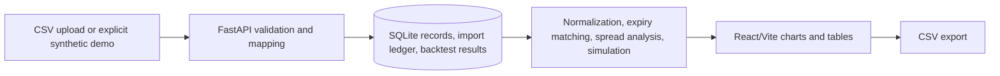

# Architecture

The frontend calls a configurable API base URL (`VITE_API_URL`, default `http://localhost:8000`). FastAPI stores imported records and backtest summaries in `data/goldlens.sqlite3` by default. `GOLDLENS_DATA_DIR` changes the data directory. Demo records use the same persistence and analysis paths as imported CSV rows.
